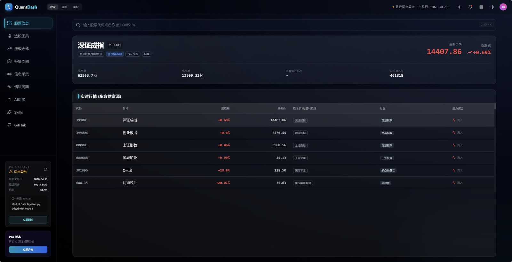
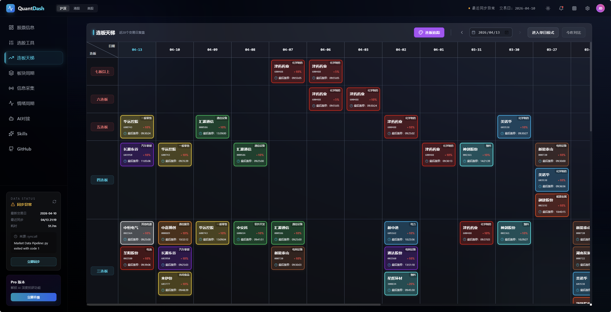
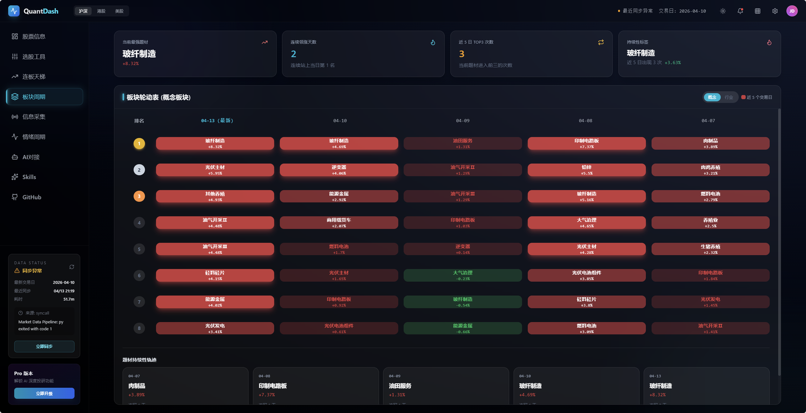
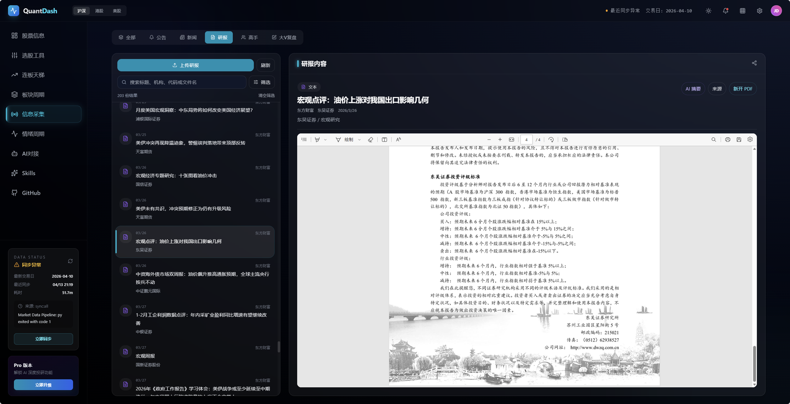
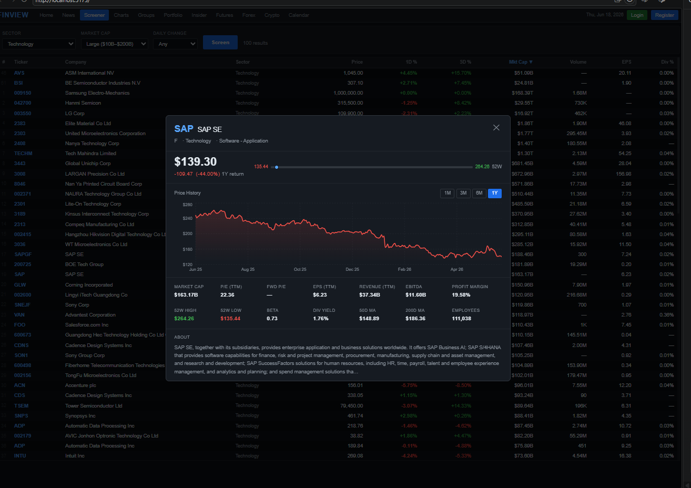
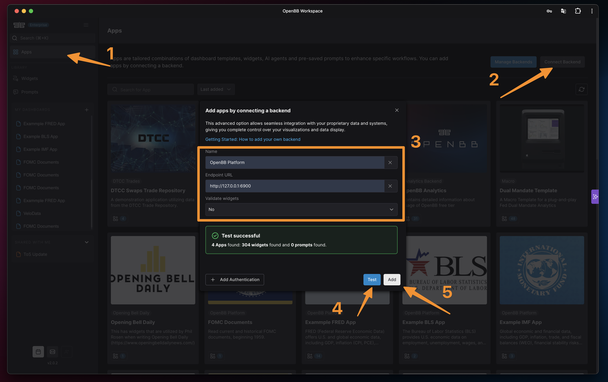
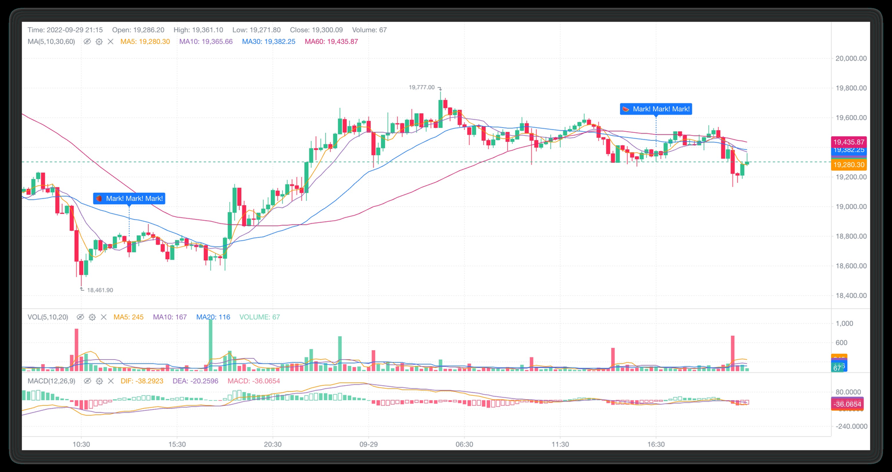
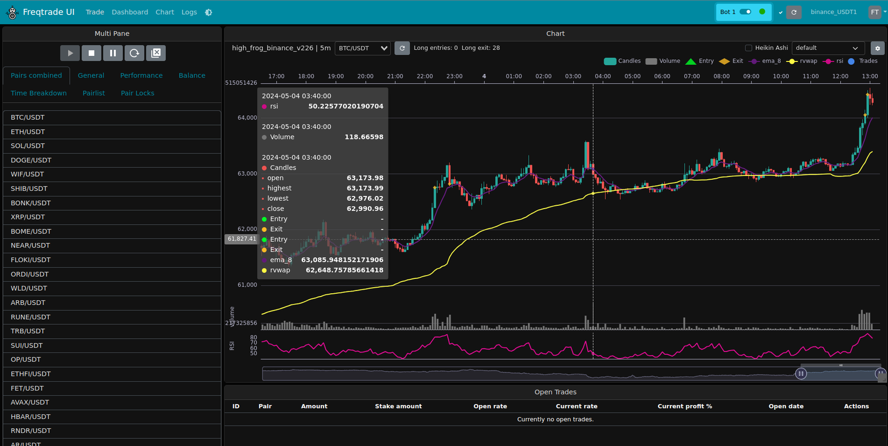

# A 股量化前端设计参考调研

> 调研时间：2026-11-07  
> 目标：为 **apps/dsa-web** 找可复用的设计经验，不复制他人代码与素材。  
> 说明：截图仅用于内部分析，版权归原作者；落地前请以各仓库 LICENSE 为准。  
> 配套高保真原型：[候选池 + Agent Trace](prototype/index.html)（含 4 张截图与交互说明）

## 0. 结论先行

你现在的 Web 端更像一个“Agent 功能集合”：链路、消息、K线、信号、入场、质量、持仓、回测并列，首页直接跳到 **/agent-trace**。  
但量化用户的实际路径是 **看市场 → 找标的 → 看个股证据 → 做计划 → 回测/复盘 → 查 Agent 为什么这么判断**。

建议按 6 条原则改造：

1. **从“功能导航”改成“工作流导航”**：工作台 / 市场 / 研究 / 策略 / Agent / 系统。
2. **补一个市场驾驶舱首页**：指数、涨跌家数、板块轮动、今日信号、数据与 Agent 健康状态。
3. **补一个个股详情页**：把 K线、信号、新闻、财务、计划、Trace 收进同一个股票上下文，而不是让用户在 5 个页面之间拼信息。
4. **表格按专业终端设计**：高密度、粘性表头、列设置、保存视图、行抽屉，而不是普通卡片列表。
5. **Agent Trace 是差异化，但不该是首页**：它应该是“证据与审计”页，用时间线/树 + 证据卡呈现，而不是默认落地页。
6. **视觉从“AI Demo”收敛到“专业终端”**：减少大面积渐变、发光和超大圆角，强化数字层级、边框、密度和红绿语义。

## 1. 你现在的基线

技术栈：React 19 + TypeScript + Vite + Tailwind 4 + ECharts + Recharts + Zustand + motion。

现有页面：

~~~text
/agent-trace                       链路（当前首页）
/news-signals                      消息
/kronos                            K线
/signal-preview                    信号
/agent-entry-execution-backtests   入场
/seed-pool-quality                 质量
/portfolio                         持仓
/backtest                          回测
/settings                          设置
~~~

当前结构上有 3 个明显问题：

- **首页错位**：**/** 直接跳 **/agent-trace**，用户第一眼看到的是 Agent 执行细节，不是市场或持仓。
- **页面按功能切碎**：同一个股票的证据散落在 K线、消息、信号、链路、入场回测五个页面。
- **导航标签过短**：“链路 / 消息 / 质量 / 入场”对熟悉项目的人没问题，对新用户和未来的你自己都不够自解释。

## 2. 值得参考的项目

### 2.1 QuantDash：最接近你的 A 股看盘/复盘工作台

- 仓库：https://github.com/rancy777/quantdash-ai-stock
- 技术栈：Vite + React
- 许可：PolyForm Noncommercial 1.0.0（只借鉴交互，不复制代码/素材）

值得借鉴：

- **左侧深色导航 + 顶部市场切换 + 全局搜索 + 数据状态**，信息密度高但不乱。
- **市场总览**：指数大卡 + 关键统计 + 实时表格，一屏完成“今天市场怎么样”。
- **连板天梯**：用矩阵表达“高度 × 日期”，是 A 股特有信息，比折线图更直观。
- **板块轮动**：排名条 + 红绿强度 + 题材持续性轨迹，适合做“今日主线”。
- **研究资料库**：三栏结构（筛选 / 列表 / 阅读器），对新闻、研报、公告都适用。
- **情绪周期**：指标 tab + KPI 行 + 多折线/阶梯线，适合表达“周期位置”。

不要照搬：

- 左侧底部 Pro 升级卡、重复的数据状态卡，会稀释主任务。
- 2552px 超宽截图下的信息密度，直接搬到 1440px 会过挤，需要做响应式取舍。
- 它的视觉偏“深色 SaaS”，你的项目可以更“研究终端”一点。

### 2.2 Finviz：选股器和市场脉搏的经典范式

- 产品：https://finviz.com/screener.ashx
- 开源复刻：https://github.com/Kevinelectronics/finviz-clone-claude-code-eodhd

值得借鉴：

- **顶部指数卡 + 市场宽度条**（上涨/下跌、新高/新低、均线上方比例）。
- **分组信号表**：涨幅榜、跌幅榜、新高、新低、放量、活跃，一屏扫完。
- **板块热力图**：用颜色面积表达板块强弱，比单纯列表更快。
- **选股器 + 行内详情**：筛选条件在顶部，结果表格占满，点行打开详情，不离开上下文。

不要照搬：

- 字体过小、信息过密，中文环境可读性会更差。
- 视觉偏旧，适合借鉴结构而不是皮肤。

### 2.3 OpenBB：研究平台的“工作区/组件”模型

- 仓库：https://github.com/OpenBB-finance/OpenBB
- 文档：https://docs.openbb.co/workspace

值得借鉴：

- **App / Widget / Dashboard 三层模型**：把“一个分析视图”当成可保存的工作区，而不是固定页面。
- **左侧 rail + 顶部 tab + 卡片网格**，适合把行情、财务、新闻、AI Copilot 组合在一个工作区。
- **数据后端连接**和“数据来源”意识很强，适合你这种多数据源 + fallback 的项目。

不要照搬：

- 它的 marketplace、连接器、权限体系对单用户项目过重。
- 你不需要“应用商店”，但可以借鉴“保存视图/工作区”的概念。

### 2.4 KLineChart：专业 K 线图的结构参考

- 仓库：https://github.com/klinecharts/KLineChart
- 站点：https://klinecharts.com

值得借鉴：

- **价格 / 成交量 / MACD 三面板**的经典比例和联动。
- 十字光标、tooltip、MA 图例、markPoint、缩放条的组合方式。
- 浅色和深色主题都能保持一致的信息层级。

落地建议：你已经有 ECharts，不必为了 K 线再引入一套图表库；但可以按它的结构重做个股详情页的图表区。如果后续需要“画线、指标参数、复权切换、逐帧回放”，再评估 KLineChart。

### 2.5 FreqUI：回测与交易监控的流程参考

- 仓库：https://github.com/freqtrade/frequi
- 文档：https://www.freqtrade.io/en/stable/freq-ui/

值得借鉴：

- **回测是一个流程**：选策略 → 参数 → 时间区间 → 运行 → 结果，而不是一个“回测结果页”。
- 图表、交易表、bot 状态同屏，适合盘中/盘后监控。
- 左侧品种列表 + 中间图表 + 底部交易表，是交易类界面的稳定布局。

不要照搬：

- 表单式的管理后台气质偏重；你的回测页应该更像“研究报告”，而不是“配置面板”。

### 2.6 Mastermind Terminal：机构终端的视觉语言

- 仓库：https://github.com/mastermindx-market-intelligence/mastermind-terminal

它在 README 里明确写了设计方向：**black chrome、navy chart、flat-blue accent**，页面包括 Terminal / Screener / Scripts / Alerts / Portfolio，核心组件是 watchlist + verdict card + screener + portfolio。

值得借鉴：

- **“判断卡”（verdict card）**：把胜率、盈亏比、CAGR、regime 等结论压缩成一张卡，而不是散落在多个图表。
- **watchlist 列设置 + 多图表 + 右侧 verdict** 的布局。
- 颜色克制：黑/深蓝/单一蓝色强调，红绿只用于涨跌。

### 2.7 A 股产品：同花顺 / 雪球 / 富途的个股详情结构

- 同花顺自选模块拆解：https://www.uisdc.com/redesign-your-edge
- 雪球鸿蒙电脑版说明（个股详情：顶部行情、中部 K线/盘口/资金、底部讨论/公告）：https://www.donews.com/news/detail/4/6571200.html

值得借鉴：

- **自选股分组**：分组卡片 / 列表 / 展开模式，解决“股票很多”的问题。
- **个股详情是纵向叙事**：先看价格与涨跌，再看 K线/盘口/资金，最后看新闻、公告、讨论。
- **移动端优先的粘性报价头**：滚动时价格和涨跌始终可见。

## 3. 横向拆解：你应该复刻的不是“皮肤”，是这些模式

### 3.1 导航：从 9 个平级入口变成 5 组

建议：

~~~text
工作台        /                         新增：市场驾驶舱
市场           /market                  指数、宽度、板块、情绪
研究           /candidate-pool          候选池/选股
              /stock/:code             新增：个股详情
              /news-signals            新闻/事件
              /signal-preview          信号
策略           /backtest                回测
              /agent-entry-execution-backtests
              /seed-pool-quality
Agent          /agent-trace             Trace
              /tasks                   任务/定时（后续）
系统           /portfolio               持仓
              /settings                设置
~~~

导航项在展开时用完整中文标签，折叠时用图标 + tooltip；不要再用“链路/质量”这种只有作者懂的缩写。

### 3.2 首页：市场驾驶舱

~~~text
┌ 顶部状态条：交易日 / 数据新鲜度 / Agent 运行状态 / 全局搜索 ─────────────┐
├ 指数卡 x4（上证 / 深证 / 创业板 / 沪深300，含 sparkline、成交额、涨跌家数）─┤
├ 今日信号 / 候选池（2/3）                 │ Agent 运行 + 数据健康（1/3） ─┤
├ 板块轮动（排名条 / 热力图，2/3）          │ 新闻 / 事件流（1/3） ─────────┤
└──────────────────────────────────────────────────────────────────────────┘
~~~

原则：

- 首屏只回答 3 个问题：**市场怎么样、今天看什么、系统是否正常**。
- 不要把所有指标都塞进首页；细节放二级页。
- 数据新鲜度用一条紧凑状态条，不要单独占一张大卡。

### 3.3 个股详情：把散落的信息收进一个上下文

~~~text
┌ 粘性头部：名称/代码/价格/涨跌/市场状态/标签/操作 ─────────────────────┐
├ 主图（K线 + 计划线 + 信号标记，2/3）      │ 右栏：Agent 判断卡 / 计划 / 风险（1/3）─┤
├ Tabs：概览 / 证据 / 新闻 / 财务 / 回测 / Trace ────────────────────────┤
└ 底部：相关信号、持仓、历史决策 ────────────────────────────────────────┘
~~~

这是你当前最缺的一页。现在用户要在 K线、消息、信号、链路之间跳；个股详情页可以显著降低认知成本。

### 3.4 候选池 / 选股：表格是主角

- 顶部：筛选 chips + 保存视图 + 列设置 + 结果数。
- 表格：粘性表头、数字右对齐、表格数字字体、行高 34–36px。
- 行点击：右侧 drawer 展示 mini chart、证据、信号、加入自选/加入组合。
- 颜色：红涨绿跌；风险/警告用 amber，不要用红绿表达非涨跌语义。
- 空状态：告诉用户“为什么没有结果”和“下一步怎么放宽条件”。

### 3.5 回测：像研究报告，不像配置后台

~~~text
┌ 左侧参数（策略 / 区间 / 成本 / 复权 / 滑点） │ 右侧结果 ────────────────┐
│                                              │ 指标条：收益/回撤/Sharpe/胜率 │
│                                              │ 权益曲线 + 回撤 + 月度收益    │
│                                              │ 交易明细 / 持仓 / 归因        │
└──────────────────────────────────────────────┴───────────────────────────┘
~~~

必须显示：数据区间、复权方式、交易成本、样本数、是否含未来函数/数据泄漏提示。  
这些“研究可信度”信息，比多画一条曲线更重要。

### 3.6 Agent Trace：差异化功能，用审计视角设计

参考：LangSmith（https://docs.langchain.com/langsmith）、Langfuse（https://langfuse.com/docs/observability/features/agent-graphs）。

建议：

- 顶部：目标、状态、总耗时、token、模型、数据版本。
- 左侧：span 树 / 时间线（planner → tools → evidence → debate → judge → risk gate）。
- 右侧：选中步骤的输入/输出、工具名、耗时、错误、证据引用。
- 支持按错误/工具/Agent 过滤，支持两次运行 diff。
- 不要把原始 JSON 直接铺满页面；JSON 只作为“查看原始数据”的抽屉。

### 3.7 视觉系统：专业终端的 8 条规则

1. **深色优先**，浅色可选；交易/研究场景长时间盯屏，深色更稳。
2. **一个主强调色**（你现在的 cyan 可以保留），紫色降为辅助，不要两个都抢。
3. **红涨绿跌**，并且只在价格/涨跌/盈亏语义使用；风险用 amber，信息用蓝。
4. **数字用等宽/表格数字**，价格、涨跌幅、成交额右对齐。
5. **减少渐变和发光**：面板用 1px 边框 + 微阴影，靠层级和留白区分。
6. **圆角收敛**：卡片 10–12px，按钮 8px；现在的 1rem/1.5rem 偏“AI 产品”。
7. **密度可调**：默认 34px 行高，提供“紧凑/舒适”切换。
8. **动效只用于状态变化**：150ms 左右；粒子背景、超大 hero 动效不适合研究终端。

## 4. 建议的设计 token

可以在现有 CSS 变量体系上覆盖，不必重写 Tailwind：

| Token | 建议值 | 用途 |
| --- | --- | --- |
| --bg-canvas | #070B12 | 页面底色 |
| --bg-panel | #0F1622 | 卡片/面板 |
| --bg-elevated | #151F2E | 浮层/抽屉 |
| --border | rgba(148,163,184,0.14) | 常规边框 |
| --text-primary | #E6EDF7 | 主文字 |
| --text-secondary | #94A3B8 | 次要文字 |
| --accent | #22D3EE | 主强调（保留品牌 cyan） |
| --up | #F04452 | A 股上涨/盈利 |
| --down | #16C784 | A 股下跌/亏损 |
| --warning | #F59E0B | 数据过期/风险提示 |
| --radius-card | 12px | 卡片 |
| --row-height | 34px | 表格默认 |

字体：Inter + Noto Sans SC；所有数字加 tabular-nums。

## 5. 分阶段落地建议

### P0：结构改造（1–2 天）

- 导航分组 + 折叠 tooltip。
- 新增 **/** 市场驾驶舱（先用现有 API 组装，不新增后端）。
- 新增 **/stock/:code** 个股详情壳（K线 + 判断卡 + tabs）。
- 把 **/agent-trace** 从首页降为 Agent 组入口。

### P1：核心页面升级（3–5 天）

- 候选池表格：列设置、保存视图、行抽屉。
- 回测页：参数区 + 指标条 + 权益/回撤 + 交易明细 + 数据可信度提示。
- 首页接入板块轮动/涨跌家数。

### P2：差异化与打磨

- Agent Trace 时间线/树 + diff + 证据卡。
- 移动端粘性报价头、底部 tab。
- 统一 ECharts 主题、tooltip、颜色语义。

## 6. 需要你确认

1. **目标用户**：只你自己每天复盘，还是给团队/客户用？这决定信息密度和 onboarding。
2. **先改哪 1–2 个页面**：市场驾驶舱 / 个股详情 / 候选池 / 回测 / Agent Trace。
3. **视觉方向**：深色专业终端（QuantDash 风格）/ 浅色现代 SaaS（OpenBB 风格）/ 双主题但默认深色。
4. **交付方式**：只要这份调研 + 参考图，还是继续出高保真原型，或直接改 apps/dsa-web 代码。
5. **Agent Trace 的定位**：保留为核心差异化，还是弱化为“高级诊断”入口。

## 7. 来源

- QuantDash：https://github.com/rancy777/quantdash-ai-stock
- Finviz：https://finviz.com/screener.ashx
- Finviz 开源复刻：https://github.com/Kevinelectronics/finviz-clone-claude-code-eodhd
- OpenBB：https://github.com/OpenBB-finance/OpenBB
- OpenBB Workspace 文档：https://docs.openbb.co/workspace
- KLineChart：https://github.com/klinecharts/KLineChart
- KLineChart 站点：https://klinecharts.com
- FreqUI：https://github.com/freqtrade/frequi
- FreqUI 文档：https://www.freqtrade.io/en/stable/freq-ui/
- Mastermind Terminal：https://github.com/mastermindx-market-intelligence/mastermind-terminal
- 同花顺自选模块拆解：https://www.uisdc.com/redesign-your-edge
- 雪球鸿蒙电脑版说明：https://www.donews.com/news/detail/4/6571200.html
- LangSmith：https://docs.langchain.com/langsmith
- Langfuse Agent Graphs：https://langfuse.com/docs/observability/features/agent-graphs
- QuantConnect 回测结果文档：https://www.quantconnect.com/docs/v2/cloud-platform/backtesting/results
- RiceQuant 回测文档：https://www.ricequant.com/doc/quant/backtest
