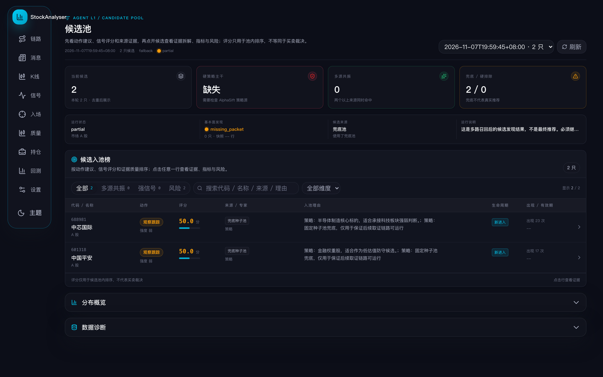
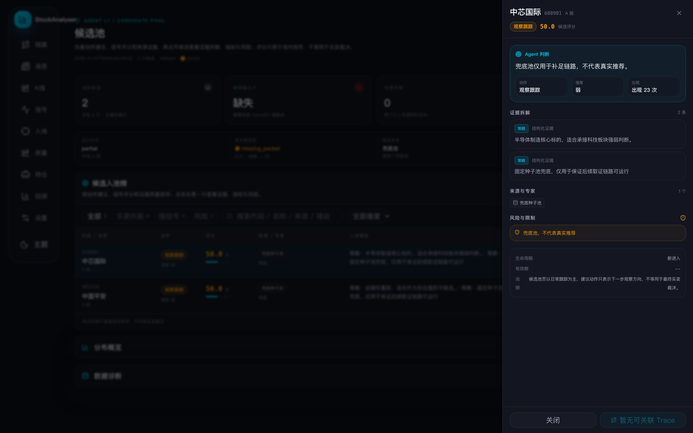

# 候选池落地记录

日期：2026-11-07  
目标：把 QuantDash 风格的候选池设计落到现有 React 页面，同时保持 API 和业务语义不变。

## 改动文件

- apps/dsa-web/src/pages/CandidatePoolPage.tsx
- apps/dsa-web/src/components/candidates/CandidatePoolTable.tsx（新增）
- apps/dsa-web/src/components/candidates/CandidatePoolDrawer.tsx（新增）
- apps/dsa-web/src/pages/__tests__/CandidatePoolPage.test.tsx

## 页面能力

- 顶部保留运行选择与刷新，展示运行时间、候选数、来源、状态。
- KPI：当前候选、硬策略主干、多源共振、兜底 / 硬排除。
- 数据质量条：运行状态、基本面发现、候选来源、运行说明。
- 稠密表格：代码 / 名称、动作、评分、来源 / 专家、入池理由、生命周期、出现 / 有效期。
- 筛选：全部 / 多源共振 / 强信号 / 风险；代码 / 名称 / 来源 / 理由搜索；维度下拉。
- 行抽屉：Agent 判断、证据拆解、来源与专家、关键指标、风险与限制、生命周期与说明。
- 分布概览、数据诊断收纳到折叠区，不抢占主任务。

## 真实数据语义修复

真实来源会出现 fallback_seed_pool，原有判断只认 fallback / fallback:*，导致：

- 兜底候选被标成“进入深挖”；
- 风险 Tab 显示 0，但 KPI 显示有兜底。

已统一用 isFallbackSource 判断，fallback_seed_pool 现在：

- 动作显示“观察跟踪”；
- 风险 Tab 计数正确；
- 来源显示“兜底种子池”。

## 验证

- npm run lint：通过，无 warning。
- npm run build：通过。
- CandidatePoolPage 测试：4 条通过（原有 2 条 + 抽屉 + fallback 语义）。
- 真实浏览器（http://127.0.0.1:5173/candidate-pool）：
  - 2 条真实候选渲染；
  - 风险 Tab 为 2；
  - 第一行动作为“观察跟踪”；
  - 行抽屉可打开/关闭；
  - 无关联 Trace 时按钮显示“暂无可关联 Trace”；
  - 控制台 0 报错。

## 截图

## 未做 / 下一步

- 侧边导航分组（原型中的 5 组导航）尚未落到真实 Shell。
- 市场驾驶舱首页、个股详情页尚未落地。
- Agent Trace 页面下一步按原型改造。
- 真实 API 当前只有 2 条兜底候选，因此页面比原型稀疏；等有正常候选数据后密度会更接近设计稿。
- 源码区仍有未提交回退文件，本次只改了候选池相关文件，未触碰其余回退。
