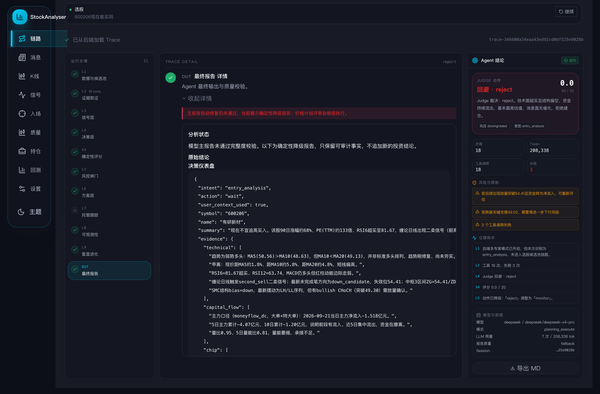
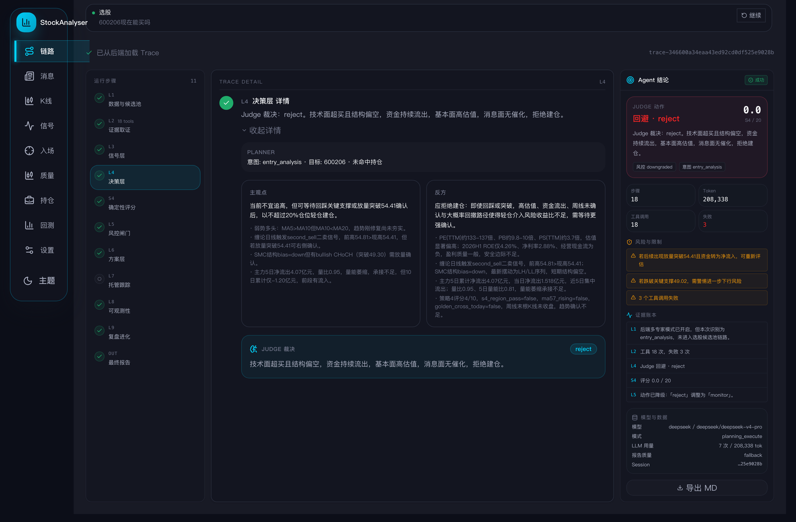
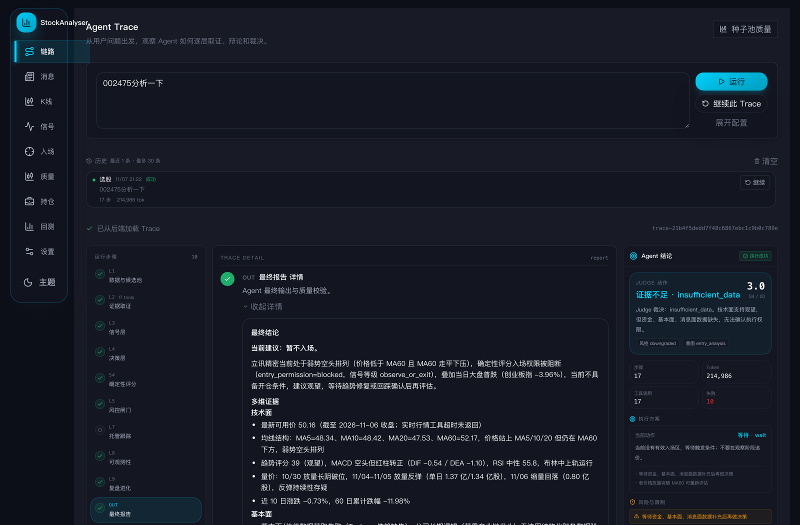
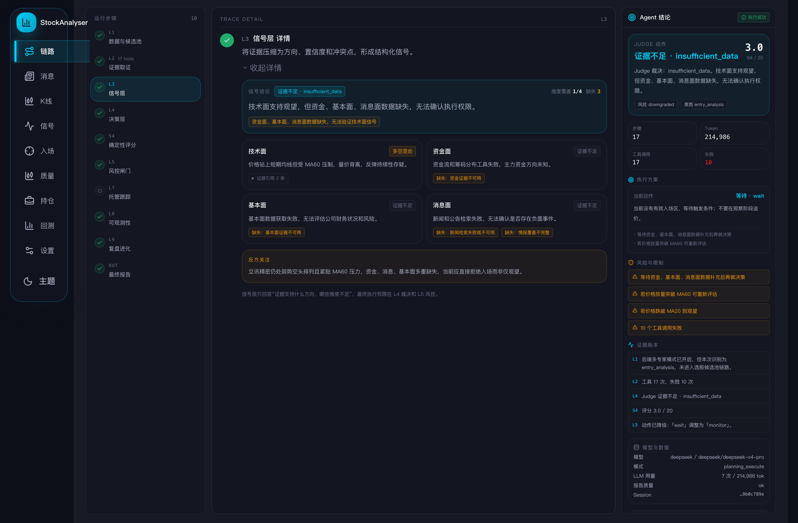
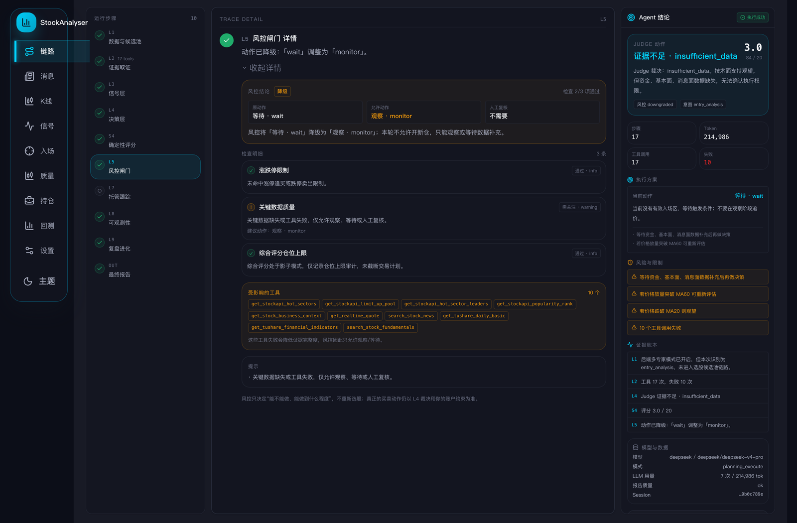
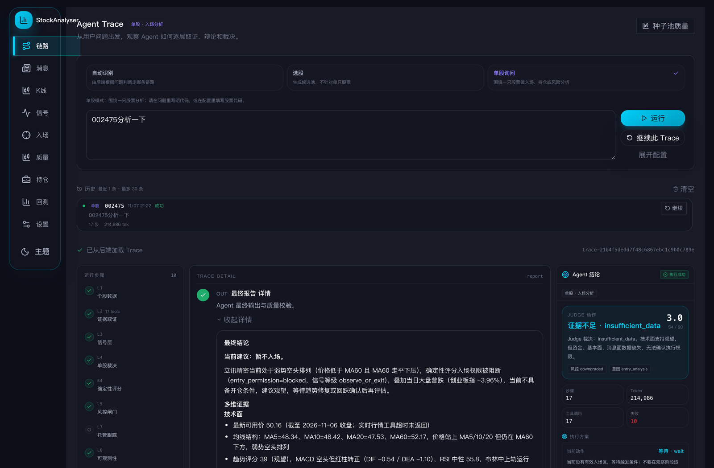
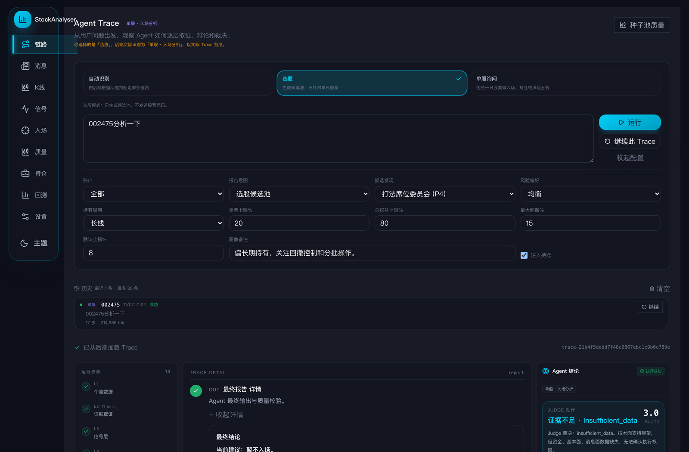

# 候选池 + Agent Trace 落地记录

日期：2026-11-07  
目标：把 QuantDash 风格的候选池和 Agent Trace 设计落到现有 React 页面，同时保持 API、测试和业务语义不变。

## 改动文件

- apps/dsa-web/src/pages/CandidatePoolPage.tsx
- apps/dsa-web/src/components/candidates/CandidatePoolTable.tsx（新增）
- apps/dsa-web/src/components/candidates/CandidatePoolDrawer.tsx（新增）
- apps/dsa-web/src/pages/__tests__/CandidatePoolPage.test.tsx

## 页面能力

- 顶部保留运行选择与刷新，展示运行时间、候选数、来源、状态。
- KPI：当前候选、硬策略主干、多源共振、兜底 / 硬排除。
- 数据质量条：运行状态、基本面发现、候选来源、运行说明。
- 稠密表格：代码 / 名称、动作、评分、来源 / 专家、入池理由、生命周期、出现 / 有效期。
- 筛选：全部 / 多源共振 / 强信号 / 风险；代码 / 名称 / 来源 / 理由搜索；维度下拉。
- 行抽屉：Agent 判断、证据拆解、来源与专家、关键指标、风险与限制、生命周期与说明。
- 分布概览、数据诊断收纳到折叠区，不抢占主任务。

## 真实数据语义修复

真实来源会出现 fallback_seed_pool，原有判断只认 fallback / fallback:*，导致：

- 兜底候选被标成“进入深挖”；
- 风险 Tab 显示 0，但 KPI 显示有兜底。

已统一用 isFallbackSource 判断，fallback_seed_pool 现在：

- 动作显示“观察跟踪”；
- 风险 Tab 计数正确；
- 来源显示“兜底种子池”。

## 验证

- npm run lint：通过，无 warning。
- npm run build：通过。
- CandidatePoolPage 测试：4 条通过（原有 2 条 + 抽屉 + fallback 语义）。
- 真实浏览器（http://127.0.0.1:5173/candidate-pool）：
  - 2 条真实候选渲染；
  - 风险 Tab 为 2；
  - 第一行动作为“观察跟踪”；
  - 行抽屉可打开/关闭；
  - 无关联 Trace 时按钮显示“暂无可关联 Trace”；
  - 控制台 0 报错。

## 截图

## Agent Trace 落地

改动文件：

- apps/dsa-web/src/pages/AgentTracePage.tsx
- apps/dsa-web/src/components/agent/TraceStepNav.tsx（新增）
- apps/dsa-web/src/components/agent/TraceVerdictPanel.tsx（新增）

布局：

- 左侧：L1-L9 + 最终报告，共 11 个步骤；显示状态、工具数和当前选中项。
- 中间：只展示当前选中步骤，所有步骤内容仍保留在 DOM 中，避免破坏现有 Trace 详情与测试。
- 右侧：Agent 结论卡，包含 Judge 动作、S4 评分、风险与限制、证据账本、模型与数据、导出 MD。
- Judge 动作按语义着色：买入/加仓绿色，回避/减仓/卖出红色，持有/等待青色。
- L4 原来在深色页面里的白底“Judge 裁决”卡改为深色证据卡。

验证：

- npm run lint：通过。
- npm run build：通过。
- AgentTracePage 测试：27 条全部通过。
- 真实 Trace（trace-346600a34eaa43ed92cd0df525e9028b）：
  - 11 个步骤、18 次工具调用正常加载；
  - 左侧步骤切换正常；
  - 右侧 Judge 动作为“回避 · reject”，风险与证据账本正常；
  - 控制台 0 报错。

截图：

## Agent Trace 体验迭代（2026-11-07）

针对真实使用反馈，做了 4 处调整：

1. 历史记录
   - 上限从 10 条提升到 30 条。
   - 每条显示发送时间（MM/DD HH:mm）、执行状态、步骤数、Token。
   - 列表高度提升到 320px，可滚动查看；标题显示“最近 N 条 · 最多 30 条”。
   - 新发起的运行记录开始时间；从后端补加载的旧 Trace 仍使用加载时间，后续需要后端在 Trace 响应里返回 created_at。
   - 状态文案改为“执行成功/执行失败”，避免和投资结论混淆。

2. 信号层 L3
   - 不再只显示 verdict（真实数据里常是 -）。
   - 改为：信号结论、维度覆盖/缺失数、每个维度的 plan_verdict + 摘要、证据引用、缺失原因、反方关注。
   - 技术面/资金面/基本面/消息面分别成卡，空数据会明确写“缺失：资金证据不可用”等。

3. 风控闸门 L5
   - 增加“风控结论”：原动作 → 允许动作、检查通过数、人工复核、以及“这意味着什么”。
   - 检查明细显示规则中文名、通过/需关注、message、建议动作。
   - 增加“受影响的工具”列表和阻断原因/提示。

4. 方案层 L6
   - 删除原始 JSON 的 L6 步骤。
   - 方案摘要收进右侧 Agent 结论卡：当前动作、是否有有效入场区、触发条件；没有有效计划时明确写“当前没有有效入场区”。

截图：

验证：

- AgentTracePage 27 条测试通过。
- lint / build 通过。
- 真实 Trace（21b4f5 / 17 次工具调用、10 次失败）下，L3 显示 1/4 维度覆盖、3 个缺失；L5 显示 2/3 检查通过、10 个受影响工具；页面无控制台错误。
- 这条 Trace 的失败工具是 PySocks 修复前的数据；重跑后 L3/L5 的证据会更新。

## 2026-11-07 Trace 工具失败排查

Trace：data/agent_traces/20261107-211807-trace-21b4f5dedd7f48c6867ebc1c9b0c789e

结果：17 次工具调用中 10 次失败：

- get_stockapi_hot_sectors / get_stockapi_limit_up_pool / get_stockapi_hot_sector_leaders / get_stockapi_popularity_rank
- get_stock_business_context
- get_realtime_quote
- search_stock_news
- get_tushare_daily_basic
- get_tushare_financial_indicators
- search_stock_fundamentals

根因：macOS 系统启用了 SOCKS 代理（127.0.0.1:10795），后端 requests 自动读取代理，但 .venv 只有 httpx 用的 socksio，没有 requests 用的 PySocks，因此所有 requests 调用在 0.01–6 秒内报 InvalidSchema: Missing dependencies for SOCKS support；实时行情批次最终 75 秒超时。

修复：

- 在 .venv 安装 PySocks 1.7.1。
- requirements.txt 增加 PySocks>=1.7.1。
- 建议重启后端一次，确保 requests/urllib3 的 SOCKS 模块重新加载。

修复后验证：

- requests + SOCKS：腾讯行情接口 200。
- Tushare daily_basic：返回 3 条，002475.SZ 收盘 50.05。
- 实时行情：UnifiedRealtimeQuote 返回，source=TUSHARE。
- 板块归属：返回 47 个板块。
- AnySearch：search_stock_news 返回 2 条结果。

尚未逐个重跑：4 个 StockAPI 工具、fina_indicator、search_stock_fundamentals。它们走同一 requests/SOCKS 链路，预期恢复，但需要下一次 Trace 确认。

## Agent Trace 双路由区分（2026-11-07）

问题：选股和单股询问在页面上没有区别，用户发起前不知道自己会走哪条链路，运行后也看不出实际走了哪条。

输入区改为三态路由：

- 自动识别（默认）：保持原有 auto intent，由后端根据问题判断；运行后显示实际路由。
- 选股：report_intent 固定为 watchlist_scan；隐藏并清空股票代码；显示候选发现。
- 单股询问：report_intent 为 entry_analysis / position_review / risk_review / event_impact；显示股票代码；隐藏候选发现。

运行后：

- 顶部显示实际路由 badge，例如“单股 · 入场分析”“选股 · 候选池”。
- L1 标题随路由变化：选股为“数据与候选池”，单股为“个股数据”。
- L4 标题随路由变化：选股为“组合裁决”，单股为“单股裁决”。
- 右侧 Agent 结论卡显示实际路由。
- 显式选择与后端实际 intent 不一致时，顶部提示以实际 Trace 为准。
- 历史记录显示“选股/单股”badge，并从问题或结果里补全股票代码。

截图：

验证：

- 默认“自动识别”保持原有 payload 与 27 条页面测试。
- lint / build 通过。
- 真实 Trace 加载后显示“单股 · 入场分析”，L1 为“个股数据”，L4 为“单股裁决”。
- 切到选股后，股票代码字段隐藏，报告意图变为“选股候选池”，候选发现显示。

## 选股链路耗时优化（2026-11-07）

Trace：data/agent_traces/20261107-221411-trace-976a4dec6c2e47dead54e54839edaa24

耗时拆解（约 55 分钟）：

- 工具总耗时：231 秒，66 次调用；不是主要瓶颈。
- candidate_discovery：约 34 分钟；其中 momentum_desk 独占约 31.5 分钟，62 次 LLM 调用，31 只股票逐个串行分析。
- 后续 deep dive / screening / meta / pricing / allocation / adversarial / judge：约 20 分钟，其中大多数是单次串行 LLM 阶段。

本轮改动：

- BaseDeskExpert.run_desk 增加 row_concurrency 参数，按股票分批有界并发。
- 生产配置 AGENT_DESK_ROW_CONCURRENCY 默认 3；单测默认 1，保持原有串行语义。
- 并发按原 eligible 顺序收集结果，保留 per_seed_packets 顺序、per-seed 超时和连续失败熔断。
- 诊断中增加 desk_row_concurrency，记录并发度与 eligible_rows。

预期：

- momentum_desk 的 31.5 分钟串行等待预计降到约 10–12 分钟（3 路并发）。
- 整条选股链路预计从约 55 分钟降到约 30–35 分钟；实际值取决于 LLM 延迟和限流。

本轮未做：

- 单次 LLM turn 内的多个工具调用仍是串行；工具总耗时只有 231 秒，优先级低于股票行并发。
- 两个 deep dive 目标仍是串行，后续可并行。
- meta_orchestrator 与 pricing_agent 目前仍按依赖顺序执行，后续可评估并行。
- 最终报告阶段的单次 LLM 延迟仍需靠模型/提示词优化，不能简单并行。

验证：

- python -m py_compile 通过。
- tests/test_candidate_experts_v2.py + tests/test_candidate_committee.py：61 条通过。
- 新增并发回归：两个行必须同时在飞，否则 barrier 超时；验证 row_concurrency=2 时输出顺序仍为 600000、000001。

## 未做 / 下一步

- 侧边导航分组（原型中的 5 组导航）尚未落到真实 Shell。
- 市场驾驶舱首页、个股详情页尚未落地。
- Agent Trace 的“两次运行 diff”、错误筛选、输入/输出 raw JSON 抽屉尚未落地。
- 真实 API 当前只有 2 条兜底候选，因此候选池比原型稀疏；等有正常候选数据后密度会更接近设计稿。
- 源码区仍有未提交回退文件，本次只改了候选池和 Agent Trace 相关文件，未触碰其余回退。
