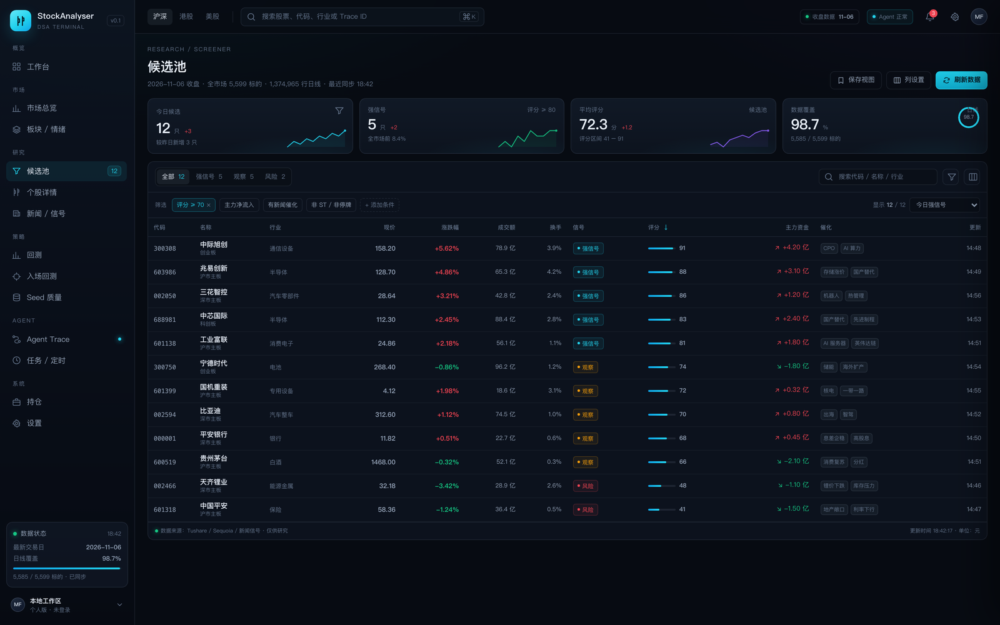
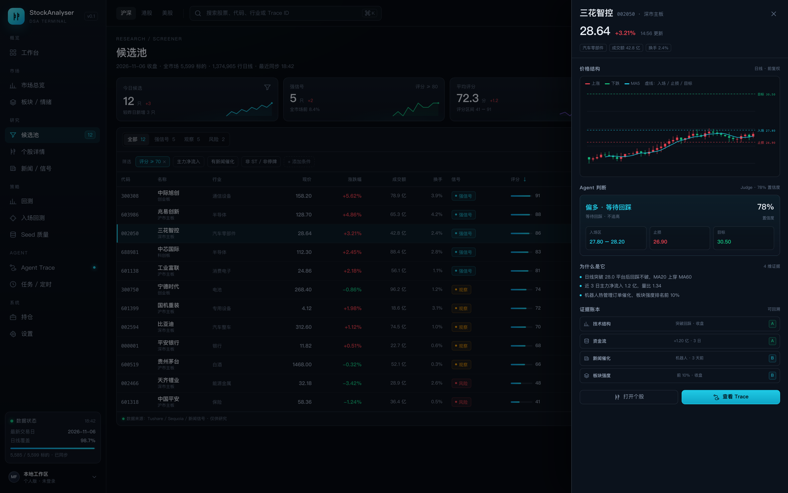
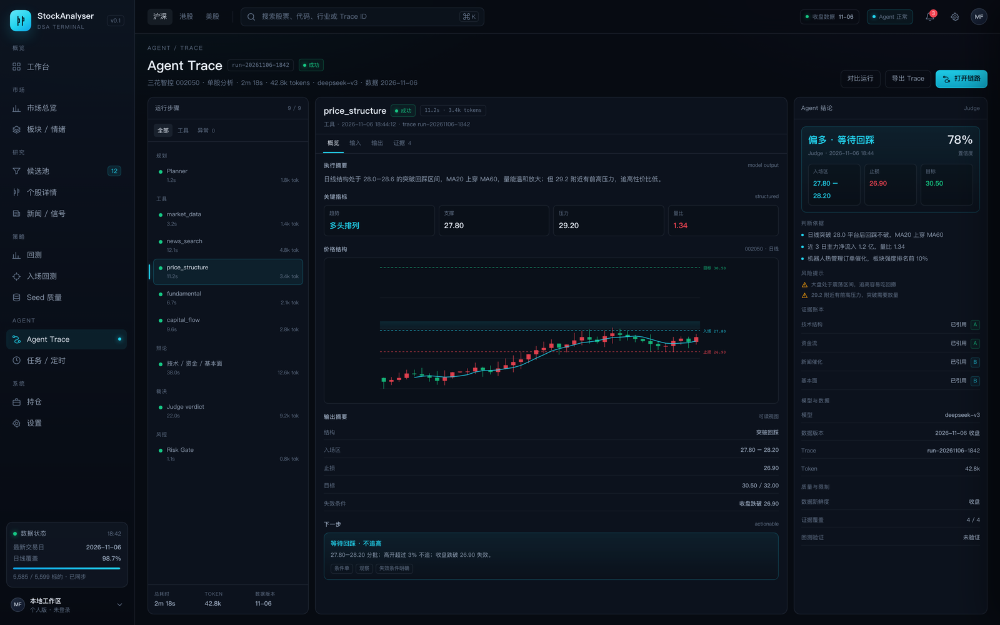
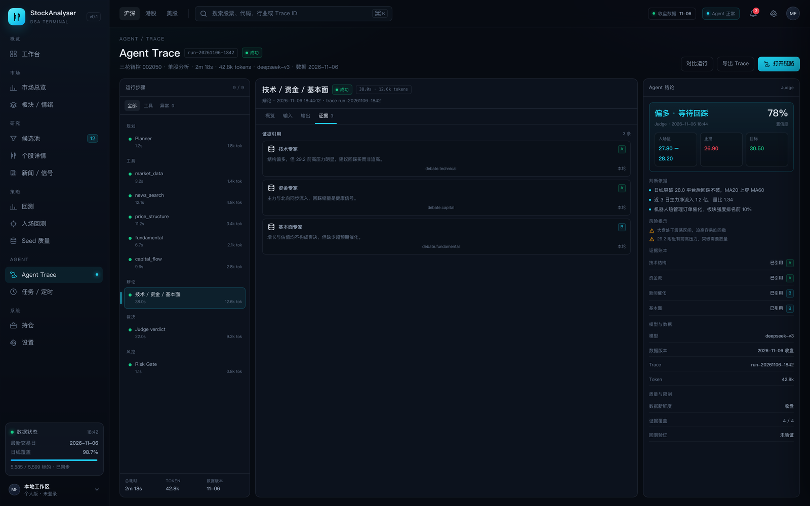

# DSA Terminal 高保真原型

这是候选池 + Agent Trace 的独立高保真原型，用于确定视觉和交互方向，不依赖后端，也不修改现有 React 源码。

## 打开方式

~~~bash
cd docs/design/prototype
python3 -m http.server 8090
~~~

然后打开：

- 候选池：http://127.0.0.1:8090/
- Agent Trace：http://127.0.0.1:8090/#trace

也可以直接双击 index.html；如果浏览器限制 file:// 下的 history API，用上面的本地服务最稳。

## 可交互内容

候选池：

- 全部 / 强信号 / 观察 / 风险筛选（12 / 5 / 5 / 2）
- 代码 / 名称 / 行业搜索
- 评分排序（点击“评分”表头）
- 点击任意行打开右侧抽屉
- 抽屉内查看 K 线、入场区、止损、目标、Agent 判断、证据账本
- Esc 或点击遮罩关闭抽屉

Agent Trace：

- 左侧 9 个运行步骤，按规划 / 工具 / 辩论 / 裁决 / 风控分组
- 点击步骤切换右侧详情
- 概览 / 输入 / 输出 / 证据四个 tab
- 工具 / 异常筛选
- 右侧 Agent 结论、判断依据、风险提示、证据账本
- 顶部市场切换、导航未展开项会给出 toast 提示

## 视觉方向

对齐 QuantDash 的专业终端语言：

- 深海军蓝画布，面板用 1px 边框而不是大面积渐变
- 单一 cyan 强调 + A 股红涨绿跌
- 表格行高 38px，数字右对齐、等宽数字
- 卡片 10–12px 圆角，弱阴影
- 顶部状态条：交易日、数据新鲜度、Agent 状态
- 关键结论用“判断卡”而不是散落的图表

## 截图

候选池：

候选池行抽屉：

Agent Trace：

Agent Trace 证据：

## 映射到 apps/dsa-web

建议按现有页面逐步替换，而不是一次性重写：

| 原型区域 | 对应现有文件 | 落地方式 |
| --- | --- | --- |
| 侧边导航 | components/layout/SidebarNav.tsx | 从 9 个平级入口改成 5 组，保留折叠图标 |
| 候选池 KPI + 表格 | pages/CandidatePoolPage.tsx、components/candidates/CandidateDecisionTable.tsx | 增加 KPI 条、筛选 chips、列设置、行抽屉 |
| 行抽屉 | 新增 CandidateDrawer | 复用 K 线组件，展示判断卡与证据 |
| Agent Trace 步骤树 | pages/AgentTracePage.tsx | 左侧步骤树 + 右侧 tab 详情，替代纯 JSON/长列表 |
| Agent 结论卡 | 新增 VerdictCard | 复用现有评分、风控、证据字段 |
| 设计 token | src/index.css、tailwind.config.js | 覆盖深色变量，收敛渐变/圆角 |

数据接入时只需要替换 app.js 里的 mock 数组：

- candidates：候选池行、K 线 seed、判断、证据
- traceSteps：Trace 步骤、输入输出、证据

## 边界

- 数据全部为 mock，不请求真实 API。
- 没有登录、权限、移动端深度适配；移动端只做了基础折叠。
- 首页市场驾驶舱、个股详情、回测页尚未画，建议作为下一轮原型。
- 参考项目的截图和设计仅用于分析；不要直接复制其代码或素材，落地前确认 LICENSE。
