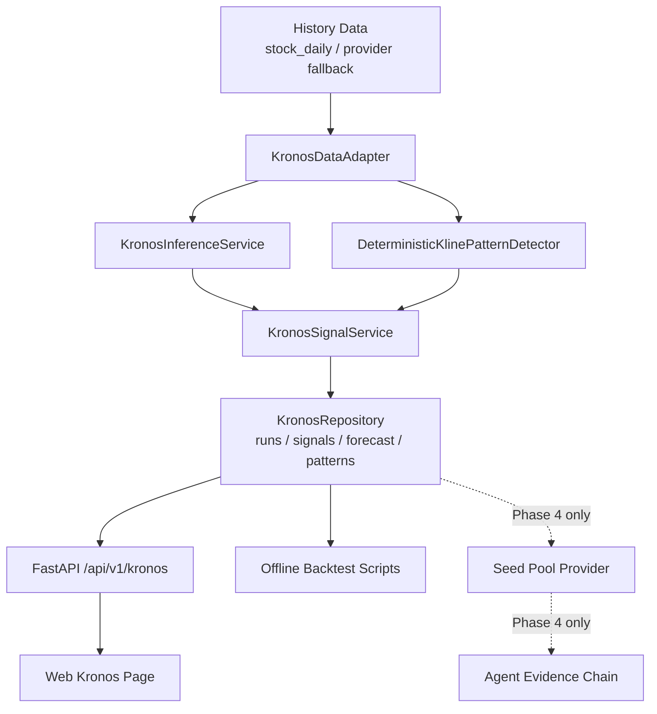

# Kronos K线形态检测集成设计

> 目标：将本地 `Kronos/` 预训练预测模型接入 StockAnalyser，形成可落地、可回测、可解释的 A 股日线 K线形态展示与候选池证据链。本文以当前仓库实现为 Phase 1 基线；未实现能力会明确标注 Phase，避免设计和代码继续漂移。

## 1. 背景与结论

本地 `Kronos/` 仓库是原版 Kronos foundation model，核心能力是对 OHLCV K线序列做自回归预测：

- `model/KronosTokenizer`：把连续 OHLCV 序列量化为层次化 token。
- `model/Kronos`：decoder-only Transformer。
- `model/KronosPredictor`：封装输入校验、时间特征、逐样本归一化、预测和反归一化。

因此，Kronos 本身不是“W底/M顶识别器”。它提供未来 K线分布预测，StockAnalyser 的形态层由两类来源组成：

- **deterministic**：确定性 chart pattern 检测，例如 W底、M顶、头肩顶、头肩底、箱体突破、三角收敛。
- **kronos_derived**：从 Kronos 预测轨迹派生出的形态确认、突破、修复、顶部风险等概率证据。

当前结论：

- Phase 1 只接入 A 股日线。
- Phase 1 前端提供独立 Kronos 页面，支持选股、展示历史 K线、未来预测、红框形态和基础评估信息。
- Phase 1 不允许 Kronos 自动进入 seed 池；所有自动入池必须等待第 10 节离线回测 gate 达标。
- Phase 2 再训练或加载 P-Kronos 7 分类模型，直接输出买卖点概率。
- Phase 4 才允许批量扫描并进入 seed pool / Agent 链路。

## 2. 设计原则

- 不把外部 `Kronos/` 代码直接混入主业务路径；新增适配层隔离模型路径、设备、依赖和失败降级。
- Kronos 输出只作为“技术形态证据”，不直接越过 Risk Gate/Judge 给买卖指令。
- 数据口径、复权口径、模型参数、版本和采样配置必须进入 run 记录或参数指纹，保证回测可复现。
- `pattern_type` 全项目只保留一套 canonical enum；来源差异使用 `origin` / `detector` / `evidence` 区分。
- 回测 gate 的交易协议、阈值和样本要求在跑实验前冻结，禁止事后调参凑达标。
- 单一 Kronos 依赖失败不能拖垮主分析、Web 和 seed pool。

## 3. 总体架构



模块边界：

| 层 | 文件 | 职责 | 状态 |
| --- | --- | --- | --- |
| 后端适配 | `src/services/kronos_data_adapter.py` | 从日线 DataFrame 转 Kronos 输入格式，统一字段、日期和价格口径 | 已实现 |
| 确定性形态 | `src/services/kline_pattern_detector.py` | W底、M顶、头肩、箱体、三角等规则检测 | 已实现 |
| 模型推理 | `src/services/kronos_inference_service.py` | 加载 Kronos tokenizer/model，执行 forecast | 已实现 |
| 信号融合 | `src/services/kronos_signal_service.py` | 合并确定性形态、预测派生形态和信号摘要 | 已实现 |
| 数据访问 | `src/repositories/kronos_repo.py` | 保存 run、signal、forecast、pattern | 已实现 |
| ORM | `src/storage.py` | `KronosModelRun`、`KronosSignal`、`KronosForecastPoint`、`KronosPatternInstance` | 已实现 |
| API schema | `api/v1/schemas/kronos.py` | Kronos 请求/响应 schema | 已实现 |
| API endpoint | `api/v1/endpoints/kronos.py` | `GET /status`、`POST /signals/analyze` | Phase 1 已实现 |
| Web API/types | `apps/dsa-web/src/api/kronos.ts` | 前端请求方法和 TypeScript 类型 | 已实现 |
| Web 页面 | `apps/dsa-web/src/pages/KronosPage.tsx` | K线图、预测、形态红框、状态展示 | 已实现 |
| Agent tool | `src/agent/tools/kronos_tools.py` | 将 Kronos 证据暴露给 Agent | Phase 4 计划 |
| Seed provider | `src/agent/candidate_providers/kronos_provider.py` | 回测达标后按形态原因入 seed 池 | Phase 4 计划 |

## 4. 算法设计

### 4.1 输入标准化与价格口径

KronosPredictor 需要：

- `df`: columns 为 `open/high/low/close/volume/amount`，index 为 `DatetimeIndex` 或 date-like 列。
- `x_timestamp`: 与历史窗口对齐。
- `y_timestamp`: 未来预测时间戳。

Phase 1 固定口径：

- 只支持 A 股日线，`frequency = 1d`。
- 图表坐标、模型输入、红框价格和 forecast 反归一化统一使用 StockAnalyser 的现金价展示口径，禁止直接使用 Sequoia raw 后复权价格。
- `src/services/history_loader.py` 会通过 `src/services/sequoia_price_rebaser.py` 对 Sequoia / db cache 的异常价格做归一化：优先使用主库重叠交易日校准；无重叠时使用 `amount / volume` 反推 VWAP 缩放；遇到近期复权因子跳变时使用滚动因子修正。
- 每次 run 必须在 `data_quality_json` 或 `source_chain_json` 中记录 `price_basis`、`price_adjustment_basis`、`price_adjustment_factor`、数据源和窗口日期范围。
- 同一 run 内禁止混用 raw 后复权、现金展示、前复权等不同价格基准。
- 历史 run 的红框价格坐标绑定当时的 `price_basis`。如果后续切换到严格前复权或修改 rebase 逻辑，旧 overlay 只能通过保存的 basis/factor 重算后再和新图表叠加。

缺失处理：

- `amount` 缺失时按 `volume * mean(open, high, low, close)` 估算，并在 `data_quality.flags` 记录 `estimated_amount`。
- `volume` 缺失时填 0，并记录 `missing_volume`。这类 run 不允许进入 seed pool gate 主样本。
- 历史窗口低于 `lookback` 或非有限价格被过滤后不足样本，直接返回 `insufficient_history`，不触发模型推理。

### 4.2 统一 `pattern_type` 枚举与来源

`pattern_type` 是跨数据库、API、前端 overlay、回测统计和 seed reason 的 canonical enum。禁止再维护第二套“第一版形态”枚举。

| `pattern_type` | 中文标签 | 方向 | 允许来源 | `detector` |
| --- | --- | --- | --- | --- |
| `double_bottom` | W底 | bullish | deterministic | `deterministic_kline_patterns_v1` |
| `double_top` | M顶 | bearish | deterministic | `deterministic_kline_patterns_v1` |
| `head_shoulders_top` | 头肩顶 | bearish | deterministic | `deterministic_kline_patterns_v1` |
| `inverse_head_shoulders_bottom` | 头肩底 | bullish | deterministic | `deterministic_kline_patterns_v1` |
| `range_breakout` | 箱体突破 | bullish | deterministic, kronos_derived | `deterministic_kline_patterns_v1` 或 `kronos_forecast_heuristic_v1` |
| `triangle_consolidation` | 三角收敛 | neutral | deterministic | `deterministic_kline_patterns_v1` |
| `bottom_reversal` | 底部反转确认 | bullish | kronos_derived | `kronos_forecast_heuristic_v1` |
| `breakout_pullback` | 突破回踩候选 | bullish | kronos_derived | `kronos_forecast_heuristic_v1` |
| `volume_price_repair` | 量价修复 | bullish | kronos_derived | `kronos_forecast_heuristic_v1` |
| `top_reversal_risk` | 顶部反转风险 | bearish | kronos_derived | `kronos_forecast_heuristic_v1` |

消费规则：

- `range_breakout` 只有一个 canonical 类型。确定性检测要求历史箱体压缩后放量突破；Kronos 派生检测要求预测路径支持向上突破或突破延续。两者判据不同，但都写入同一个 `pattern_type`，差异只从 `evidence.detector` / `evidence.origin` 读取。
- `evidence.detector` 为必填；当前实现可以由 detector 反推 `origin`。后续 schema 迁移时应显式写入 `evidence.origin = deterministic | kronos_derived | p_kronos_classifier`。
- 前端筛选和回测聚合必须同时展示 `pattern_type` 和 `detector/origin`，不得只按 `pattern_type` 合并解释。
- `kronos_confirmation` 是确认状态，不是形态枚举。可取 `confirmed`、`contradicted`、`watch`、`kronos_derived`。

### 4.3 确定性 chart pattern 检测

确定性检测只看历史 K线，不看未来预测。Phase 1 使用 `src/services/kline_pattern_detector.py`：

- W底：两个近似低点、中间颈线、第二低点不明显破位。
- M顶：两个近似高点、中间颈线、第二高点不能有效突破。
- 头肩顶：左肩、头部、右肩和颈线结构。
- 头肩底：左肩、头部、右肩和颈线结构。
- 箱体突破：一段时间振幅收敛后向上突破区间上沿。
- 三角收敛：高点下降、低点抬升、振幅压缩。

确定性 pattern 写入 `kronos_pattern_instances` 时：

- `detector = deterministic_kline_patterns_v1`
- `origin = deterministic`，当前可由 detector 派生
- `start_index/end_index` 对应历史 bar 区间
- `evidence` 保存颈线、箱体上下沿、关键 pivot、突破强度等结构化字段

### 4.4 Kronos 预测派生形态与采样置信度

原版 Kronos 的输出是未来 OHLCV 预测，不是形态标签。Phase 1 通过 `KronosSignalService` 从预测路径派生概率形态：

- `bottom_reversal`：历史位于低位区，预测终点收益为正，预测最大回撤有限。
- `range_breakout`：历史处于箱体或压缩区，预测高点/收盘价突破近期区间。
- `breakout_pullback`：历史已有突破，预测回踩不破关键位后继续修复。
- `volume_price_repair`：预测价格上行且成交量/成交额不明显衰退。
- `top_reversal_risk`：历史涨幅较大，预测收益转负或下行风险显著。

采样口径：

- 当前实现中 `KRONOS_SAMPLE_COUNT` 默认值为 1。交互页面优先保证可用性和响应速度，不默认多路径采样。
- 离线 A/B 或回测评估应使用 `sample_count >= 10` 才计算分位数置信区间；如果 CPU/GPU 成本不可接受，必须在实验报告中写明降级原因。
- 多路径预测不能只取平均路径。应从采样分布派生：
  - `close_p10/p50/p90`
  - `high_p10/p50/p90`
  - `low_p10/p50/p90`
  - `terminal_return_p10/p50/p90`
  - `max_drawdown_p50/p90`
  - `dispersion_pct`
- `confidence` 应优先由分布离散度、方向一致率、样本数和数据质量折扣推导；没有多路径样本时只能标注为 heuristic confidence。
- 前端在 `sample_count >= 10` 且 API 返回分位数时，应画 P10/P50/P90 预测带，而不是只画单条 forecast。

### 4.5 Phase 2：P-Kronos 7 分类

`docs/kronos/` 中的 P-Kronos 设计属于 Phase 2，不是当前已上线能力。目标标签：

- `strong_buy`
- `buy`
- `watch`
- `hold`
- `reduce`
- `sell`
- `risk_avoid`

训练原则：

- Backbone 可复用 Kronos tokenizer/model 权重。
- 分类头单独训练，标签由未来窗口收益、回撤、成交量和分形结构离线生成。
- 所有标签生成规则、训练窗口、验证窗口和 A 股交易规则必须冻结后再训练。
- 上线前必须通过第 10 节 gate；未达标不得进入 seed pool。

### 4.6 信号融合

Phase 1 不使用拍脑袋的数值权重。当前规则：

- 先保留所有确定性 pattern，并用 Kronos forecast 给出 `confirmed`、`contradicted` 或 `watch`。
- 再从预测路径派生 `kronos_derived` pattern。
- `bias` 由预测收益、下行风险、risk/reward、形态方向和数据质量规则共同决定。
- `confidence` 取结构置信、预测置信和数据质量折扣后的保守值。
- `seed_gate_status` 默认是 `backtest_pending`，即使单次信号很强也不得自动入池。

Phase 2 有 P-Kronos 分类概率后，才允许引入可校准融合公式。候选公式必须通过离线回测学习或网格搜索得到，并写入模型版本/参数指纹。若 `p_kronos_classification_side` 缺失，不进行权重归一化补洞。

### 4.7 涨跌停、停牌与数据质量

A 股日线信号生成阶段就必须标注交易可达性，不能只在分钟线回测中处理。

`data_quality.flags` 至少包含：

| flag | 判定 | 影响 |
| --- | --- | --- |
| `has_suspension_gap` | lookback 内出现明显交易日缺口，或数据条数低于交易日历预期 | 降低 confidence，不进入 gate 主样本 |
| `limit_locked` | 当日 high/low/open/close 近似相等且涨跌幅接近 10%/20%/30% 档 | 标记为不可成交或低可达性 |
| `limit_up_close` | 收盘接近涨停但非一字板 | bullish 信号保留，但回测需检查次日能否买入 |
| `limit_down_close` | 收盘接近跌停 | bearish/risk 信号保留，bullish 信号降级 |
| `estimated_amount` | amount 由 volume 和均价估算 | 降低 confidence |
| `missing_volume` | 成交量缺失 | 不进入 seed gate |
| `price_rebased` | 价格经过 Sequoia/main/db cache rebase | 记录 basis/factor，用于复现 |

对于 `limit_locked` 的 bullish 信号，前端可以展示，但 seed gate 和批量扫描必须视为 `unfilled` 或降级候选，避免出现“涨幅空间够但真实买不进”的假信号。

## 5. 数据库设计

当前 ORM 在 `src/storage.py` 中定义，Phase 1 已落地四张表。

### 5.1 `kronos_model_runs`

用途：记录一次模型或规则分析运行，作为所有 signal、forecast、pattern 的父记录。

关键字段：

- `run_id`：唯一 run 标识。
- `code/market/frequency/as_of`
- `status`
- `model_name/tokenizer_name/device`
- `lookback/pred_len/max_context`
- `history_source`
- `data_quality_json`
- `diagnostics_json`
- `started_at/finished_at/created_at`

设计要求：

- 每次实际推理都新建 run，保留审计历史。
- 未来如果增加缓存命中，也应返回已有 run 或创建 cache-hit run，不直接覆盖历史记录。
- `data_quality_json` 必须记录价格口径、交易可达性 flags、样本窗口和异常处理。

### 5.2 `kronos_signals`

当前实现是按 `run_id` 追加保存 signal，没有唯一约束覆盖历史。这比按 `code/as_of/frequency/model_version/mode` upsert 更安全。

如果后续增加“latest signal cache”或 upsert 表，唯一键不能只包含 `code/as_of/frequency/model_version/mode`。必须包含参数指纹：

```text
param_hash = sha256(
  model_name,
  tokenizer_name,
  frequency,
  lookback,
  pred_len,
  sample_count,
  temperature,
  top_p,
  price_basis,
  detector_version,
  classifier_version
)
```

语义：

- 同 `param_hash` 的缓存读取可以返回最近成功 run。
- `force_refresh=true` 只表示绕过缓存并写入新 run，不删除旧 run。
- 不同 `lookback/pred_len/sample_count/temperature/top_p/price_basis` 的结果必须并存，不能互相覆盖。
- API 返回最新结果时必须明确 `run_id` 和 `param_hash`，前端保存 overlay 时绑定 run。

### 5.3 `kronos_forecast_points`

当前表按 `run_id + horizon_index` 保存聚合预测点，适合 Phase 1 单路径或聚合路径展示。

当前约束：

- `UNIQUE(run_id, horizon_index)`

如果保存多采样路径，应新增：

- `sample_index`
- `quantile`
- `path_role = raw_sample | p10 | p50 | p90 | mean`

并将唯一约束升级为：

```text
UNIQUE(run_id, path_role, sample_index, horizon_index)
```

Retention：

- 交互分析默认只保留最近 20 个成功 run/股票/参数指纹。
- 批量扫描默认只保留 180 天内 run。
- 删除 run 前先删除 `kronos_forecast_points` 和 `kronos_pattern_instances`。
- A/B 实验明细优先保存到 `data/run/kronos_ab/`，不默认灌入线上 SQLite。

### 5.4 `kronos_pattern_instances`

用途：保存前端红框、回测统计和 seed reason。

关键字段：

- `run_id`
- `pattern_id`
- `pattern_type`
- `label`
- `direction`
- `start_index/end_index`
- `start_date/end_date`
- `price_low/price_high`
- `confidence`
- `evidence_json`
- `seed_gate_status`

约束：

- `UNIQUE(run_id, pattern_id)`
- `pattern_type` 必须来自第 4.2 节 canonical enum。
- `evidence_json.detector` 必填。
- `seed_gate_status` 默认 `backtest_pending`，只有第 10 节 gate 达标并固化版本后才能变为 `approved`。

## 6. 后端服务设计

### 6.1 `KronosDataAdapter`

职责：

- 读取 `load_history_df()` 输出。
- 标准化 OHLCVA 字段。
- 检查 lookback 窗口、非有限值、价格量级、复权/rebase basis。
- 生成 `x_timestamp/y_timestamp`。
- 输出 `data_quality`。

数据质量输出示例：

```json
{
  "price_basis": "stock_analyser_cash_display_v1",
  "price_adjustment_basis": "amount_volume_vwap",
  "price_adjustment_factor": 123.45,
  "flags": ["price_rebased"],
  "lookback": 120,
  "available_bars": 120,
  "history_source": "sequoia_daily"
}
```

### 6.2 `KronosInferenceService`

职责：

- 根据配置加载 tokenizer 和 model。
- 根据 `KRONOS_ENABLED` 控制是否允许推理。
- 支持 CPU/MPS/CUDA。
- 输出 forecast bars、摘要、耗时、模型诊断。

配置要求：

- `KRONOS_ENABLED=false` 时 API 保持可用，但不会触发模型推理。
- `KRONOS_SAMPLE_COUNT` 当前默认 1；离线评估可提高到 10+。
- 模型路径和 tokenizer 路径必须来自配置，不写死到业务代码。

### 6.3 `KronosSignalService`

职责：

- 调用 data adapter 和 inference service。
- 调用 deterministic detector。
- 将 forecast 摘要转换为方向、收益、风险和 pattern 实例。
- 持久化 run/signal/forecast/pattern。
- 返回前端可直接渲染的数据结构。

失败语义：

- 未安装 `torch`：返回清晰错误，不拖垮 FastAPI 进程。
- 模型未启用：返回 disabled 状态。
- 数据不足：返回 `insufficient_history`。
- 推理超时：返回 upstream timeout，并在 diagnostics 中记录耗时阶段。

## 7. API 设计

当前 API 只收敛到 Phase 1 已实现端点。

| Method | Path | Phase | 状态 | 说明 |
| --- | --- | --- | --- | --- |
| GET | `/api/v1/kronos/status` | Phase 1 | 已实现 | 查询启用状态、模型配置、依赖状态 |
| POST | `/api/v1/kronos/signals/analyze` | Phase 1 | 已实现 | 单股单次分析并可选择持久化 |
| GET | `/api/v1/kronos/signals/latest` | Phase 2/3 | 计划 | 查询最近成功 run 的 signal |
| GET | `/api/v1/kronos/runs` | Phase 2/3 | 计划 | run 列表和筛选 |
| GET | `/api/v1/kronos/runs/{run_id}` | Phase 2/3 | 计划 | run 明细 |
| GET | `/api/v1/kronos/runs/{run_id}/forecast` | Phase 2/3 | 计划 | forecast 明细 |
| GET | `/api/v1/kronos/patterns` | Phase 2/3 | 计划 | pattern 查询和筛选 |
| POST | `/api/v1/kronos/signals/batch` | Phase 4 | 计划 | 批量扫描，必须受 gate 和成本预算约束 |
| POST | `/api/v1/kronos/backtest` | 暂不进 API v1 | 不实现 | 先使用 `scripts/run_kronos_model_ab.py` |

`POST /signals/analyze` 当前请求示例：

```json
{
  "stock_code": "600519",
  "frequency": "1d",
  "lookback": 120,
  "pred_len": 5,
  "target_date": null,
  "fallback_to_network": true,
  "persist": true
}
```

响应必须包含：

- `runId`
- `stockCode`
- `asOf`
- `bars`
- `forecast`
- `forecastSummary`
- `signal`
- `patterns`
- `dataQuality`
- `diagnostics`

未来如果加入 `force_refresh`：

- `force_refresh=false`：同 `param_hash` 可复用最近成功 run。
- `force_refresh=true`：绕过缓存，写入新 run。
- 无论哪种，都不能覆盖异参数结果。

## 8. Agent 与 Seed Pool 接入

Phase 1 只展示，不自动入池。

Phase 4 才允许新增：

- `src/agent/candidate_providers/kronos_provider.py`
- `src/agent/tools/kronos_tools.py`

入池条件：

- 对应 `pattern_type + detector/origin + 参数版本` 已通过第 10 节 gate。
- `seed_gate_status = approved`。
- 当前股票当日没有 `limit_locked`、`missing_volume`、`has_suspension_gap` 等硬降级 flag。
- seed reason 必须写清：形态类型、来源、预测收益/风险、回测版本、样本数和通过阈值。

Agent EvidenceCard 示例：

```json
{
  "source": "kronos",
  "version": "kronos_forecast_heuristic_v1",
  "code": "600519",
  "as_of": "2026-07-24",
  "pattern_type": "double_bottom",
  "origin": "deterministic",
  "detector": "deterministic_kline_patterns_v1",
  "kronos_confirmation": "confirmed",
  "expected_return_pct": 3.2,
  "down_risk_pct": 1.4,
  "confidence": 0.68,
  "seed_gate_status": "approved",
  "backtest_version": "kronos_gate_v1_202607"
}
```

## 9. 前端设计

### 9.1 页面与入口

两个入口：

- 独立页面：`/kronos`，用于选股、展示股票、可视化 K线形态、红框 overlay、预测路径和离线评估结果。
- Seed/Agent 链路入口：Phase 4 才启用，用于展示“因为某个已回测达标形态进入 seed 池”的原因。

独立页面职责：

- 股票输入和最近分析记录。
- 历史 K线 candlestick。
- 预测 K线或预测区间。
- 形态红框：红框绑定 `pattern_id`、`run_id`、`start_index/end_index`、`price_low/price_high`。
- pattern 列表：展示 `pattern_type`、中文 label、direction、confidence、detector/origin、confirmation。
- 数据质量状态：价格口径、rebase basis、涨跌停/停牌 flags。
- 回测评估：先读取离线脚本产物，不在 Phase 1 新增 API backtest。

### 9.2 UI 组件

- `KronosPage`：页面容器。
- `KronosKlineChart`：K线、forecast、红框 overlay。
- `PatternBadge`：形态标签。
- `ForecastSummaryPanel`：收益、风险、risk/reward、置信区间。
- `DataQualityPanel`：数据质量和交易可达性。
- `BacktestSummaryPanel`：Phase 2/4 读取离线 gate 结果。

红框绘制规则：

- 横轴：`start_index/end_index` 或 `start_date/end_date`。
- 纵轴：`price_low/price_high`，必须和 run 的 `price_basis` 一致。
- tooltip 展示 `pattern_type + label + detector/origin + confidence + confirmation`。
- 同一 `pattern_type` 不同 detector 的红框可同时存在，但图例必须能区分来源。

### 9.3 前端类型

当前前端类型和 API client 位于 `apps/dsa-web/src/api/kronos.ts`，不再另建 `types/kronos.ts`。

核心类型示例：

```ts
export interface KronosPatternInstance {
  patternId: string
  patternType: string
  label: string
  direction: "bullish" | "bearish" | "neutral"
  startIndex: number
  endIndex: number
  startDate?: string | null
  endDate?: string | null
  priceLow?: number | null
  priceHigh?: number | null
  confidence: number
  evidence: Record<string, unknown>
  seedGateStatus?: string
}
```

新增字段时优先追加，避免破坏桌面端或已有页面。

## 10. 离线回测 Gate

自动入 seed 池的前置条件不是“感觉效果不错”，而是通过固定 gate。

### 10.1 信号到交易协议

v1 gate 固定协议：

- 市场：A 股。
- 频率：日线。
- 信号生成时间：`as_of = T` 收盘后。
- bullish pattern：只评估做多/入池能力。
- bearish/risk pattern：只评估规避或退出价值，不做 A 股融券做空假设。
- 入场：`T+1` 下一个可交易日开盘价。
- 如果 `T+1` 停牌、无有效开盘价、`limit_locked` 一字涨停导致无法买入，则记为 `unfilled`，不计入主收益样本，但计入可达性统计。
- 如果 bullish 信号 `T+1` 开盘较 `T` 收盘高开超过 7%，记为 `chase_filtered`；主 gate 单独报告包含和剔除两组结果。
- 持有期：主指标固定 5 个交易日；同时报告 10 日和 20 日辅助指标。
- 止损：日线 v1 使用收盘确认止损。若任一日收盘价低于入场价 5%，则在下一可交易日开盘退出；如果次日不可交易，顺延到下一可交易日。
- 退出：未触发止损时在第 5 个交易日收盘退出。
- 成本：A 股 round-trip 成本固定 20 bps，计入所有收益。
- 基准：同一入场/退出窗口的沪深 300 收益，用于计算 excess return。
- 不允许使用信号日之后的信息决定是否发出信号。

### 10.2 v1 通过阈值

整体 seed gate 必须同时满足：

- filled bullish 样本数不少于 300。
- 每个被批准入池的 `pattern_type + detector/origin` 样本数不少于 50。
- 覆盖至少 24 个月历史。
- 至少覆盖一个 bearish regime 和一个 bullish regime：沪深 300 任意 60 个交易日收益 `<= -8%` 视为 bearish，`>= +8%` 视为 bullish。
- 主 5 日净胜率 `>= 53%`。
- high confidence 桶 5 日净胜率 `>= 58%`，样本数不少于 100。
- 主 5 日平均超额收益 `>= +0.30%`。
- profit factor `>= 1.10`。
- P90 adverse excursion 不低于 `-7%`。
- 策略最大回撤不超过 20%，且不比同期沪深 300 最大回撤差 5 个百分点以上。
- 单一年份或单一申万一级行业样本占比不超过 35%。
- `unfilled + chase_filtered` 占比必须单独披露；如果超过 30%，不得自动入池，只能作为观察信号。

单个 pattern 通过阈值：

- `pattern_type + detector/origin` filled 样本数 `>= 50`。
- 5 日净胜率 `>= 52%`。
- 5 日平均超额收益 `>= +0.20%`。
- P90 adverse excursion 不低于 `-8%`。
- 在 bearish regime 中不能显著失效：5 日平均超额收益不得低于 `-0.30%`。

### 10.3 防过拟合规则

- gate 阈值必须在实验前写入配置或实验说明。
- 运行完成后不得修改阈值再声明通过。
- 每次 gate 结果必须保存：参数、模型版本、数据窗口、样本数、指标、失败原因。
- 当前 `scripts/run_kronos_model_ab.py` 已支持模型 A/B 的方向、收益误差和形态聚合基础评估，但还不足以直接批准 seed gate；需要补齐交易协议、可达性、成本、止损和 regime 覆盖后才能开放自动入池。

## 11. 阶段路线

| Phase | 范围 | 退出标准 |
| --- | --- | --- |
| Phase 1 | A 股日线单股页面、确定性形态、Kronos forecast、红框 overlay、SQLite 持久化 | 单股分析稳定，价格口径正确，页面不白屏 |
| Phase 1.5 | 离线 A/B 与 gate 脚本增强 | 完整执行第 10 节协议，产出可复现报告 |
| Phase 2 | P-Kronos 7 分类训练/加载 | 验证集和回测 gate 同时达标 |
| Phase 3 | 查询型 API 和前端历史 run/评估页 | 可以复查历史 run、pattern、forecast |
| Phase 4 | 批量扫描、seed pool、Agent tool | 通过 gate，成本可控，可回滚 |
| Phase 5 | 分钟线和实时刷新 | 分钟线数据质量、涨跌停和交易可达性验证达标 |

## 12. 配置

当前已实现配置项与 `.env.example` / `src/config.py` 保持一致：

```env
KRONOS_ENABLED=false
KRONOS_REPO_PATH=Kronos
KRONOS_TOKENIZER_PATH=NeoQuasar/Kronos-Tokenizer-base
KRONOS_MODEL_PATH=NeoQuasar/Kronos-small
KRONOS_DEVICE=auto
KRONOS_MAX_CONTEXT=512
KRONOS_DEFAULT_LOOKBACK_DAILY=240
KRONOS_DEFAULT_PRED_LEN_DAILY=10
KRONOS_SAMPLE_COUNT=1
KRONOS_TOP_P=0.9
KRONOS_TEMPERATURE=1.0
KRONOS_CACHE_SIGNALS=false
```

语义：

- `KRONOS_ENABLED` 控制是否允许模型推理。
- `KRONOS_SAMPLE_COUNT=1` 适合交互页面；`sample_count >= 10` 才能输出可靠预测区间。
- `KRONOS_CACHE_SIGNALS=false` 表示默认每次分析写入新 run；若开启缓存，仍必须遵守第 5.2 节参数指纹语义。
- 批扫、seed pool 和 retention 的 Phase 4 配置尚未落地为 env；实现时必须同步 `.env.example`、`src/config.py`、`src/core/config_registry.py` 和本文档。

## 13. 批量扫描成本与 retention

全 A 股 5000+ 只股票逐只 CPU 推理会迅速变成小时级任务。多路径采样会近似按 `sample_count` 线性放大成本。

Phase 4 批扫策略：

- 先用现有候选池、自选池、流动性、成交额、ST/退市过滤和数据质量过滤，将 universe 收窄到 300-800 只。
- 默认只扫描当日有新 daily bar 的股票；无新 bar 且同 `param_hash` 已有成功 run 时复用缓存。
- 批扫异步执行，设置并发、单股 timeout、总 timeout 和失败预算。
- 对 `limit_locked`、`has_suspension_gap`、`missing_volume` 股票只生成观察信号，不进入自动 seed。
- 模型 small/base 和 `sample_count=1/10` 的耗时必须在本机或部署机上形成基准表，再决定夜间任务窗口。
- `kronos_forecast_points` 必须执行 retention：默认最近 20 个 run/股票/参数指纹或最近 180 天，取更严格者。

## 14. 风险与降级

| 风险 | 处理 |
| --- | --- |
| Kronos 依赖未安装或 `torch` 缺失 | API 返回 disabled/error 状态，主服务继续运行 |
| 模型首次下载慢或网络失败 | 页面显示上游依赖超时，支持本地模型路径 |
| 价格口径错误 | `history_loader` 和 `sequoia_price_rebaser` 归一化；run 记录 basis/factor |
| 采样置信度不足 | `sample_count < 10` 标记 heuristic，不作为 seed gate 置信证据 |
| 涨停买不进 | `limit_locked` 标记为 unfilled/降级 |
| 停牌或缺口污染 lookback | `has_suspension_gap` 降低 confidence，不进 gate 主样本 |
| 批扫成本过高 | universe 预过滤、缓存、异步、retention |
| 回测过拟合 | gate 阈值预先冻结，保存完整实验配置 |
| Agent 误用模型输出 | Kronos 只进入 EvidenceCard，Risk Gate/Judge 仍保留最终决策权 |

## 15. 验收清单

Phase 1 已完成能力应满足：

- `GET /api/v1/kronos/status` 可用。
- `POST /api/v1/kronos/signals/analyze` 可分析单只 A 股日线。
- `KRONOS_ENABLED=false` 时不触发模型推理且页面可显示状态。
- `torch` 缺失时有明确错误。
- 600519、002475 等股票图表价格处于真实可读量级，而不是 raw 后复权量级。
- 前端 K线图能渲染历史、forecast 和 pattern 红框，不因预测区空值白屏。
- `pattern_type` 来自第 4.2 节唯一 enum。
- 自动 seed pool 入口保持关闭。

Phase 4 开启前必须额外满足：

- 第 10 节 gate 完整通过。
- 批扫成本基准完成。
- retention job 或维护脚本完成。
- Agent/Seed provider 有独立测试。
- 文档、`.env.example`、API schema 和前端类型同步。
